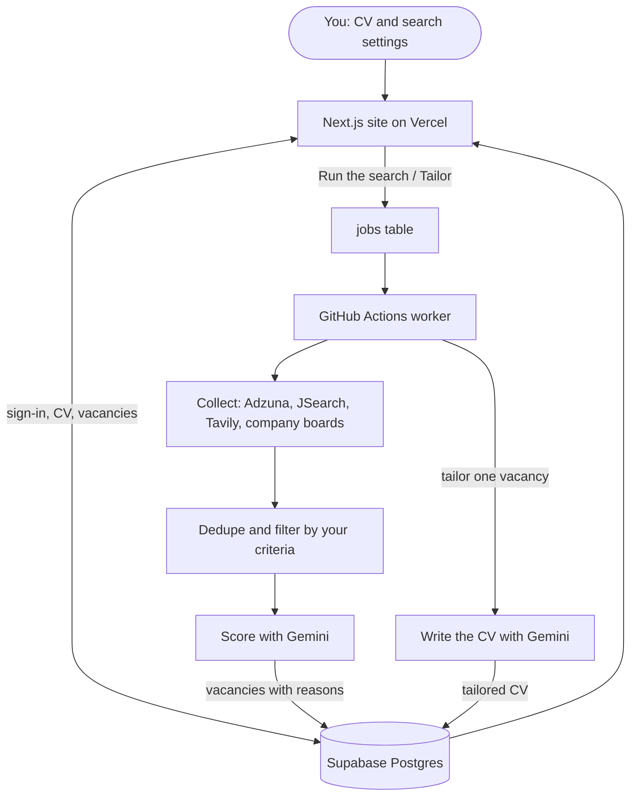

# 💼 Job Seeker

An AI agent that finds the vacancies that fit you and tailors your CV to each one.

### 🔗 **[Try it live](https://job-seeker-blush.vercel.app)**

## 🎯 The Problem

Job hunting punishes you twice. First you scroll through hundreds of listings that look relevant and are not: the wrong seniority, the wrong country, etc. Then, for the few that fit, you rewrite your CV by hand, guessing which words the recruiter is looking for and quietly hoping the keyword filter agrees with you.

## 💡 The Solution

Job Seeker searches several job APIs at once, throws out everything that fails your own criteria before paying for an AI opinion, and scores what remains against your profile. It writes a CV tailored to that posting, mirroring the vacancy's vocabulary and never inventing a single fact.

## ✨ Core Features

| Feature | Description |
|---|---|
| **Search where the jobs are** | Adzuna, JSearch (Google for Jobs), Tavily web search and company boards on Greenhouse, Lever and Ashby. A source with no key is skipped |
| **Filter before you pay** | Seniority, job function, years of experience, location and a per-company cap are applied before the model is called |
| **Score with reasons** | Gemini gives each vacancy 0-100, with what matches, what is missing and any hard blocker such as work authorisation |
| **Tailor a CV to one vacancy** | The model re-orders, re-emphasises and re-words your real experience in the posting's language. It never adds a fact, a metric or a skill |
| **Correct what the agent reads** | Upload your CV once, then fix any section the reading got wrong |
| **Track your applications** | One sheet with score, status, the date you applied, notes and columns of your own |

## 🧠 How It Works



A search takes minutes, longer than a web request can wait, so the site writes a row to the `jobs` table and starts a GitHub Actions run that does the work in Python and writes the results back to Supabase.

| Directory | Contents |
|---|---|
| `web/` | the Next.js site |
| `src/` | the Python engine: sources, filters, scoring and CV writing |
| `src/prompts/` | every prompt sent to the model, in full |
| `config/` | career tracks, filters and the company watchlist |
| `db/migrations/` | the Supabase schema, run in order |
| `tests/` | the offline test suite |

## 🚀 Quick Start

```bash
uv sync --extra dev
cp .env.example .env              # only GOOGLE_API_KEY is required
cp profile/example_profile.yaml profile/master_profile.yaml

uv run jobseeker search-and-score --track energy
uv run jobseeker adapt-cv --vacancy-id energy-0817-02
uv run pytest -q
```

The website runs from `web/` with `npm install` and `npm run dev`. Setting up the database is described in [db/README.md](db/README.md).

## 🔑 API Keys

| Key | Powers | Free tier |
|---|---|---|
| `GOOGLE_API_KEY` | scoring and CV writing (Gemini) | yes |
| `ADZUNA_APP_ID` · `ADZUNA_APP_KEY` | keyword job search | ~1,000 calls/month |
| `RAPIDAPI_KEY` | JSearch: listings from Google for Jobs | limited |
| `TAVILY_API_KEY` | web search for vacancies the APIs miss | ~1,000 searches/month |

Company career boards need no key. List the companies you care about in `config/watchlist.yaml`.

## 🧩 Built With

| Stack | Used for |
|---|---|
| **Google Gemini** | Scores each vacancy against your profile and writes the tailored CV |
| **LangChain** | Wraps the model calls in the Python engine |
| **Adzuna · JSearch · Tavily** | Find the vacancies |
| **Greenhouse · Lever · Ashby** | Read company career boards directly |
| **Python** | Runs the search, the filters and the scoring |
| **Next.js** | Renders the whole website |
| **Tailwind CSS** | Styles the website |
| **Supabase** | Stores accounts, CVs, searches and vacancies, with Google sign-in |
| **GitHub Actions** | Runs each search and each CV in the background |
| **Vercel** | Hosts the website |

## 📄 License

Copyright © 2026 Olga Aksenova.

The code in this repository is licensed under the **[Apache License, Version 2.0](https://www.apache.org/licenses/LICENSE-2.0)** – see [LICENSE](LICENSE) for the full text.
