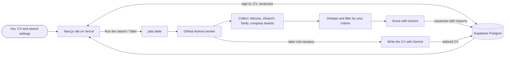

# Job Seeker

An AI agent that finds the right job opportunities, rewrites your CV in the employer's language, and turns every application into your strongest pitch. Open [Job Seeker](https://your-own-job-seeker.vercel.app), sign in with Google and start your first search. Your data stays private to your account.

## Why It Matters

Job hunting means hours of scrolling through listings that look right and are not, and then rewriting your CV for each one that does. Job Seeker does it for you. It searches several job APIs at once and keeps only the vacancies that match your experience and your preferences. For each one, it writes a CV tailored to that posting to raise your ATS match score without inventing a single fact.

## How It Works



## Project Structure

| Directory | Contents |
|---|---|
| `web/` | the Next.js site |
| `src/` | the Python engine: sources, filters, scoring and CV writing |
| `src/prompts/` | every prompt sent to the model, in full |
| `config/` | career tracks, filters and the company watchlist |
| `db/migrations/` | the Supabase schema, run in order |
| `tests/` | the offline test suite |

## Quick Start

```bash
uv sync --extra dev
cp .env.example .env              # only GOOGLE_API_KEY is required
cp profile/example_profile.yaml profile/master_profile.yaml

uv run jobseeker search-and-score --track energy
uv run jobseeker adapt-cv --vacancy-id energy-0817-02
uv run pytest -q

cd web && npm install && npm run dev
```

Database setup: [db/README.md](db/README.md).

## API Keys

| Key | Powers |
|---|---|
| `GOOGLE_API_KEY` | Scoring and CV writing (Gemini) |
| `ADZUNA_APP_ID` · `ADZUNA_APP_KEY` | Keyword job search |
| `RAPIDAPI_KEY` | JSearch: listings from Google for Jobs |
| `TAVILY_API_KEY` | Web search for vacancies the APIs miss |

Company career boards need no key.

## 📄 License

Copyright © 2026 Olga Aksenova.

The code in this repository is licensed under the **[Apache License, Version 2.0](https://www.apache.org/licenses/LICENSE-2.0)** – see [LICENSE](LICENSE) for the full text.
